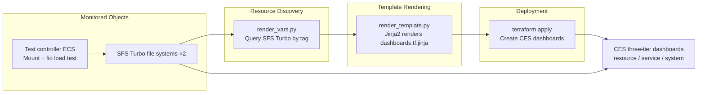

# deterministic-operations-jinja-dashboards

[](LICENSE)
[](https://support.huaweicloud.com/intl/en-us/)
[](#)
> Dynamically generate Cloud Eye dashboards (resource / service / system tiers) with Jinja templates.

## 1. Overview

This practice provides a reference implementation of "template-driven generation of Cloud Eye dashboards": it automatically discovers SFS Turbo file systems by tag, renders three tiers of monitoring dashboards (resource tier / service tier / system tier) with Jinja2 loops, and deploys them to Huawei Cloud Cloud Eye Service (CES) with a single Terraform apply. It is intended for DevOps / operations / monitoring engineers as a reference architecture and learning sample for observability construction.

### Core Capabilities

- **Template-driven**: when the number of file systems changes, only the tags need to be changed; dashboard widgets are automatically generated in loops by the Jinja templates
- **Three-tier monitoring**: resource tier for troubleshooting, service tier for aggregation, system tier for overview, covering daily monitoring perspectives
- **One-click deployment**: both infrastructure and dashboards are managed by Terraform, idempotent and reproducible
- **Traceable metrics**: every chart directly shows raw metrics (throughput / IOPS / capacity), with no hidden calculations

---

## 2. Table of Contents

- [1. Overview](#1-overview)
- [2. Table of Contents](#2-table-of-contents)
- [3. Architecture Diagram](#3-architecture-diagram)
- [4. Highlights](#4-highlights)
- [5. Cloud Services Used](#5-cloud-services-used)
- [6. Prerequisites](#6-prerequisites)
- [7. Quick Start](#7-quick-start)
- [8. Step-by-Step Deployment](#8-step-by-step-deployment)
- [9. Usage / Verification](#9-usage--verification)
- [10. Cleanup](#10-cleanup)
- [11. Detailed Explanation](#11-detailed-explanation)
- [12. Dependencies](#12-dependencies)
- [13. FAQ / Troubleshooting](#13-faq--troubleshooting)
- [14. Contributing](#14-contributing)
- [15. License](#15-license)
- [16. Contact / Maintainers](#16-contact--maintainers)

---

## 3. Architecture Diagram

> Discover resources → Render templates → Deploy dashboards → Generate data with load tests → Dashboards display data



**Key components**:
- `scripts/render_vars.py`: discovers SFS Turbo file systems by tag and outputs rendering variables
- `templates/dashboards.tf.jinja`: Jinja template that loops to generate dashboard widget definitions
- `infra/main.tf`: infrastructure such as VPC / SFS Turbo / test controller
- `scripts/user-data.tftpl`: test controller initialization (mount + load-test tools)

---

## 4. Highlights

- **Dashboards decoupled from resource count**: adding or removing a file system only requires changing a tag; the rendering script automatically generates the corresponding dashboard widgets
- **Declarative dashboard definitions**: layout, metrics, and legends all come from the template and variable files, enabling code review and version management
- **Three-tier dashboard structure**: matches the operations habit of "overview first, then service, then single-resource troubleshooting"
- **Raw metrics displayed directly**: throughput / IOPS / capacity are shown directly, making it easy to correlate with business issues

---

## 5. Cloud Services Used

| Service | Purpose | Notes |
|---|---|---|
| Cloud Eye Service (CES) | Custom dashboards and widgets | Three dashboards: resource / service / system tiers |
| Scalable File Service (SFS Turbo) | Monitored file systems | ×2, discovered by tag |
| Elastic Cloud Server (ECS) | Test controller | Mounts the file systems and runs fio load tests |
| Virtual Private Cloud (VPC) | Network isolation | Subnet / security group / EIP |

> **Tip**: all services can be created with one click through this repository's Terraform code. For cleanup, see [Section 10 "Cleanup"](#10-cleanup).

---

## 6. Prerequisites

| Item | Requirement | Description |
|---|---|---|
| **Account** | Huawei Cloud account registered and real-name verified | Personal or enterprise account |
| **Permissions** | Account has IAM **Tenant Administrator** or equivalent permissions | Create VPC / SFS Turbo / ECS / CES dashboards |
| **Region** | `cn-north-4` (Beijing-4) recommended | Other regions may differ in service availability |
| **Terraform** | `>= 1.5.0` | IaC deployment tool |
| **huaweicloud Provider** | `>= 1.94.0` | Huawei Cloud Terraform Provider |
| **Python3** | `>= 3.9` | Runtime for the rendering scripts |
| **AK/SK** | Obtain the Access Key ID and Secret Access Key on the Huawei Cloud "My Credentials" page and put them into the deployment script | **Do not** write credentials into any code or configuration file |

---

## 7. Quick Start

### One-Click Deployment (Recommended)

```bash
# 1. Clone this repository
git clone https://github.com/huaweicloud-samples/deterministic-operations-jinja-dashboards.git deterministic-operations-jinja-dashboards
cd deterministic-operations-jinja-dashboards

# 2. Prepare Huawei Cloud AK/SK (see Prerequisites §6)
export HW_ACCESS_KEY="<your-access-key>"
export HW_SECRET_KEY="<your-secret-key>"

# 3. Deploy the infrastructure
cd infra
terraform init
terraform apply -auto-approve

# 4. Render and deploy the monitoring dashboards
cd ..
python3 -m venv .venv && source .venv/bin/activate
python3 -m pip install jinja2 huaweicloudsdkcore huaweicloudsdksfsturbo
python3 scripts/render_vars.py --tag-key Application --tag-value dash-demo \
  --template dashboards.vars.jinja --rendered-file dashboards.vars.json
python3 scripts/render_template.py --template dashboards.tf.jinja \
  --template-vars dashboards.vars.json --rendered-file infra/dashboards.tf
cd infra
terraform apply -auto-approve
```

> **Deployment time**: approximately 5–10 minutes (depending on the number of resources).
> **Full steps and expected output of each step**: see [Section 8 "Step-by-Step Deployment"](#8-step-by-step-deployment).

---

## 8. Step-by-Step Deployment

### Step 1: Initialize the working directory

```bash
cd deterministic-operations-jinja-dashboards/infra
terraform init
```

**Expected output**: `Terraform has been successfully initialized!`

### Step 2: Preview resource changes

```bash
terraform plan
```

**Expected output**: `Plan: N to add, 0 to change, 0 to destroy.`

### Step 3: Deploy the infrastructure

```bash
terraform apply -auto-approve
```

**Expected output**: `Apply complete! Resources: N added, 0 changed, 0 destroyed.`

This step creates the VPC, SFS Turbo ×2, test controller ECS, EIP, and security group.

### Step 4: Record the public IP of the test controller

```bash
terraform output test_controller_public_ip
```

Record this IP; it is needed for SSH login during the load test.

### Step 5: Create a virtual environment and install rendering dependencies

```bash
cd ..
python3 -m venv .venv
source .venv/bin/activate
python3 -m pip install jinja2 huaweicloudsdkcore huaweicloudsdksfsturbo
```

**Expected output**: pip shows `Successfully installed ...`.

### Step 6: Render the template variable file

```bash
python3 scripts/render_vars.py \
  --tag-key Application --tag-value dash-demo \
  --template dashboards.vars.jinja \
  --rendered-file dashboards.vars.json
```

**Expected output**: `dashboards.vars.json` is generated, containing the list of discovered file systems.

### Step 7: Render the Terraform dashboard definitions

```bash
python3 scripts/render_template.py \
  --template dashboards.tf.jinja \
  --template-vars dashboards.vars.json \
  --rendered-file infra/dashboards.tf
```

**Expected output**: `infra/dashboards.tf` is generated, containing the `huaweicloud_ces_dashboard` and `huaweicloud_ces_dashboard_widget` resource definitions.

### Step 8: Deploy the monitoring dashboards

```bash
cd infra
terraform plan
terraform apply -auto-approve
```

**Expected output**: `Apply complete! Resources: M added, 0 changed, 0 destroyed.` (M is the number of dashboard containers + widgets)

---

## 9. Usage / Verification

> All commands / examples listed in this section have been tested in the deployment environment of this practice, run correctly, and produce output consistent with the descriptions. Please verify by following these steps.

### Verification 1: Dashboards created

Log in to the Huawei Cloud console → Cloud Eye Service (CES) → Dashboards; three dashboards should be visible:

- `dash-demo-demo-sfs-resource-tier-3` (resource tier)
- `dash-demo-demo-sfs-service-tier-2` (service tier)
- `dash-demo-demo-sfs-system-tier-1` (system tier)

**Expected result**: all three tiers exist and can be opened.

### Verification 2: File systems mounted

SSH into the test controller:

```bash
ssh <user>@<test_controller_public_ip>
df -h | grep /mnt
```

**Expected output**: two mount records for `/mnt/fs1` and `/mnt/fs2`.

### Verification 3: Load test generates metrics

```bash
fio --name=random-read-write \
  --directory=/mnt/fs1:/mnt/fs2 \
  --rw=randrw --bsrange=100k-1M,1M-4M \
  --size=4G --numjobs=16 --end_fsync=1
```

**Expected output**: fio run statistics (read / write IOPS and bandwidth).

### Verification 4: Dashboard data displayed (recommended)

Refresh the CES dashboards while the load test is running:

**Expected result**: read/write throughput and IOPS curves appear on the resource-tier and service-tier dashboards, and capacity usage is shown on the system-tier dashboard.

After deployment, follow these steps to verify that the business functionality works before considering the delivery complete.

---

## 10. Cleanup

```bash
# Enter the deployment directory
cd deterministic-operations-jinja-dashboards/infra

# Release all resources with one command
terraform destroy -auto-approve
```

**Expected output**: `Destroy complete! Resources: N destroyed.`

> **Avoid leftover resources**: `terraform destroy` releases all resources tracked in the Terraform state (VPC / SFS Turbo / ECS / EIP / dashboards); resources created manually must be released manually.

---

## 11. Detailed Explanation

### Workflow

1. **Resource discovery**: `render_vars.py` queries file systems by the `Application=dash-demo` tag using the Huawei Cloud SFS SDK, and renders `dashboards.vars.json`.
2. **Template rendering**: `render_template.py` merges `dashboards.tf.jinja` with the variable JSON to generate the Terraform dashboard definition `infra/dashboards.tf`.
3. **Dashboard registration**: `terraform apply` creates the CES dashboard containers (`huaweicloud_ces_dashboard`) and widgets (`huaweicloud_ces_dashboard_widget`).
4. **Data generation**: the test controller mounts the file systems and runs fio; metrics are collected by CES and displayed on the dashboards.

### Configuration Items

| Variable | Default | Description |
|---|---|---|
| `region` | `cn-north-4` | Huawei Cloud region |
| `sfs_turbo_size` | `500` | Capacity of a single SFS Turbo (GB) |
| `ssh_allowed_cidr` | `0.0.0.0/0` | Source CIDR allowed to SSH into the controller (tightening recommended) |
| `test_controller.cpu` | `2` | vCPU of the test controller |
| `test_controller.memory` | `4` | Memory of the test controller (GB) |

### Template Variables

| Variable | Source | Description |
|---|---|---|
| `tag_key` / `tag_value` | CLI arguments | Resource discovery tags |
| `region` | CLI argument | Query region |
| `sfs.sfs_fs` | SDK query result | Discovered file systems (name + file_system_id) |
| `sfs.widget_width` | Calculated by the rendering script | Widget width (evenly divided by the number of file systems) |

### Script Arguments

| Script | Required Arguments | Description |
|---|---|---|
| `render_vars.py` | `--tag-key` `--tag-value` `--template` `--rendered-file` | Discover resources by tag and render the variable file |
| `render_template.py` | `--template` `--template-vars` `--rendered-file` | Render any Jinja2 template to a target file |

---

## 12. Dependencies

### Main Dependencies

| Name | Version | Purpose |
|---|---|---|
| Terraform | `>= 1.5.0` | IaC orchestration |
| huaweicloud Provider | `>= 1.94.0` | Huawei Cloud resources |
| Python3 | `>= 3.9` | Rendering scripts |
| Jinja2 | `>= 3.1` | Template rendering |
| huaweicloudsdkcore | Latest | Huawei Cloud SDK core |
| huaweicloudsdksfsturbo | Latest | SFS Turbo resource discovery |

### Runtime Environment

```bash
python3 -m pip install jinja2 huaweicloudsdkcore huaweicloudsdksfsturbo
```

---

## 13. FAQ / Troubleshooting

### Q1: The rendering script says no file systems found?

**A**: confirm that the SFS Turbo file systems have the `Application=dash-demo` tag (`infra/main.tf` applies the tag automatically); or change `--tag-key` / `--tag-value` to match the resource tags.

### Q2: `terraform apply` reports insufficient CES permissions?

**A**: confirm that the account has `CES FullAccess` (or Tenant Administrator) permissions; creating CES dashboards is a write operation of Cloud Eye Service.

### Q3: A dashboard opens but has no data?

**A**: confirm that the test controller has mounted the file systems and run fio (see [Section 9](#9-usage--verification)); metrics take some time to be collected and backfilled by CES.

### Q4: SSH login to the test controller is rejected?

**A**: check whether `ssh_allowed_cidr` covers your egress IP; the security group allows `0.0.0.0/0` by default — tighten it in production.

### Troubleshooting Checklist

| Symptom | Possible Cause | How to Check |
|---|---|---|
| `render_vars.py` reports a credential error | `HW_ACCESS_KEY` / `HW_SECRET_KEY` not set | Check environment variables; confirm the keys are valid |
| Dashboard widget count is 0 | No tagged file systems discovered | Check tags; confirm SFS Turbo is deployed |
| `terraform plan` shows dashboards to be deleted | File system list changed after rendering | Re-render `dashboards.tf` before applying again |

---

## 14. Contributing

Issues and PRs are welcome. Please follow the process below:

1. **Issue**: describe the problem / suggestion (including reproduction commands, expected / actual output, and screenshots)
2. **PR**: create a feature branch from `main`; run `terraform validate` and `terraform fmt -check` before submitting

See `CONTRIBUTING.md` for detailed guidelines (if present).

---

## 15. License

This practice is released under the **MIT No Attribution** license. See the [`LICENSE`](LICENSE) file in the repository root for details.

```
MIT No Attribution

Copyright (c) Huawei Cloud

Permission is hereby granted, free of charge, to any person obtaining a copy
of this software... (no attribution required)
```

---

## 16. Contact / Maintainers
| Item | Content |
|---|---|
| **Creator** | [dgc-git](https://github.com/dgc-git) |
| **Maintainer** | [dgc-git](https://github.com/dgc-git) |
| **Contact** | GitHub Issues / PR (see [Section 14](#14-contributing)) |
