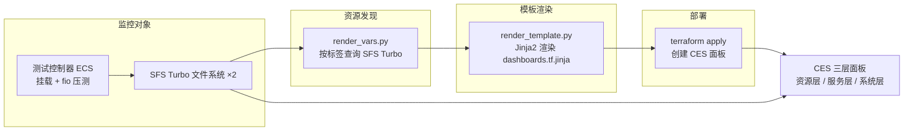

# deterministic-operations-jinja-dashboards

[](LICENSE)
[](https://support.huaweicloud.com/intl/en-us/)
[](#)
> 用 Jinja 模板动态生成云监控面板（资源层 / 服务层 / 系统层）
---

## 1. 简介 / Overview

**中文**：本实践提供一套「模板驱动生成云监控面板」的参考实现，用于按标签自动发现 SFS Turbo 文件系统，并用 Jinja2 循环渲染出三层监控面板（资源层 / 服务层 / 系统层），通过 Terraform 一键部署到华为云云监控服务（CES）。面向 DevOps / 运维 / 监控工程师，可作为可观测性建设的参考架构与学习样例。

### 核心能力

- **模板驱动**：文件系统数量变化时，只改标签，面板组件由 Jinja 模板自动循环生成
- **三层监控**：资源层排障、服务层聚合、系统层总览，覆盖日常监控视角
- **一键部署**：基础设施 + 面板全部 Terraform 管理，幂等可复现
- **指标可溯源**：每张图直接展示原始指标（吞吐 / IOPS / 容量），不做隐藏计算

---

---

## 2. 目录

- [1. 简介 / Overview](#1-简介--overview)
- [2. 目录](#2-目录)
- [3. 架构图](#3-架构图)
- [4. 方案亮点](#4-方案亮点)
- [5. 涉及云服务](#5-涉及云服务)
- [6. 前置条件](#6-前置条件)
- [7. 快速开始](#7-快速开始)
- [8. 分步部署](#8-分步部署)
- [9. 使用方法 / 验证](#9-使用方法--验证)
- [10. 清理资源](#10-清理资源)
- [11. 详细说明](#11-详细说明)
- [12. 依赖](#12-依赖)
- [13. FAQ / 故障排除](#13-faq--故障排除)
- [14. 贡献指南](#14-贡献指南)
- [15. 许可证](#15-许可证)
- [16. 联系方式 / 维护者](#16-联系方式--维护者)

---

## 3. 架构图

> 发现资源 → 渲染模板 → 部署面板 → 压测产生数据 → 面板呈现



**关键组件说明**：
- `scripts/render_vars.py`：按标签发现 SFS Turbo 文件系统，输出渲染变量
- `templates/dashboards.tf.jinja`：循环生成面板组件定义的 Jinja 模板
- `infra/main.tf`：VPC / SFS Turbo / 测试控制器等基础设施
- `scripts/user-data.tftpl`：测试控制器初始化（挂载 + 压测工具）

---

---

## 4. 方案亮点

- **面板与资源数量解耦**：新增 / 下线文件系统只改标签，渲染脚本自动生成对应面板组件
- **声明式面板定义**：布局、指标、图例全部来源于模板与变量文件，可代码评审、可版本管理
- **三层面板结构**：符合「先看总览、再查服务、最后单资源排障」的运维习惯
- **原始指标直出**：吞吐 / IOPS / 容量直接展示，便于与业务问题对应

---

---

## 5. 涉及云服务

| 服务 | 用途 | 备注 |
|---|---|---|
| 云监控服务（CES） | 自定义监控面板与组件 | 三个面板：资源层 / 服务层 / 系统层 |
| 弹性文件服务（SFS Turbo） | 被监控的文件系统 | ×2，按标签发现 |
| 弹性云服务器（ECS） | 测试控制器 | 挂载文件系统并运行 fio 压测 |
| 虚拟私有云（VPC） | 网络隔离 | 子网 / 安全组 / EIP |

> **提示**：所有服务均可通过本仓库的 Terraform 一键创建；如需清理，请参见 [第 10 节「清理资源」](#10-清理资源)。

---

---

## 6. 前置条件

| 项 | 要求 | 说明 |
|---|---|---|
| **账号** | 已开通华为云账号并完成实名认证 | 个人 / 企业账号均可 |
| **权限** | 账号具备 IAM **Tenant Administrator** 或等效权限 | 创建 VPC / SFS Turbo / ECS / CES 面板 |
| **Region** | 推荐 `cn-north-4`（北京四） | 跨区域可能涉及服务可用性差异 |
| **Terraform** | `>= 1.5.0` | IaC 部署工具 |
| **huaweicloud Provider** | `>= 1.94.0` | 华为云 Terraform Provider |
| **Python3** | `>= 3.9` | 渲染脚本运行环境 |
| **AK/SK** | 在华为云『我的凭证』页面获取 Access Key ID 与 Secret Access Key，并填入部署脚本 | **不要**将凭据写入任何代码或配置文件 |

---

---

## 7. 快速开始

### 一键部署（推荐）

```bash
# 1. 克隆本仓库
git clone https://github.com/huaweicloud-samples/deterministic-operations-jinja-dashboards.git deterministic-operations-jinja-dashboards
cd deterministic-operations-jinja-dashboards

# 2. 准备华为云 AK/SK（参见 [前置条件 §6](#6-前置条件)）
export HW_ACCESS_KEY="<your-access-key>"
export HW_SECRET_KEY="<your-secret-key>"

# 3. 部署基础设施
cd infra
terraform init
terraform apply -auto-approve

# 4. 渲染并部署监控面板
cd ..
python3 -m venv .venv && source .venv/bin/activate
python3 -m pip install jinja2 huaweicloudsdkcore huaweicloudsdksfsturbo
python3 scripts/render_vars.py --tag-key Application --tag-value dash-demo \
  --template dashboards.vars.jinja --rendered-file dashboards.vars.json
python3 scripts/render_template.py --template dashboards.tf.jinja \
  --template-vars dashboards.vars.json --rendered-file infra/dashboards.tf
cd infra
terraform apply -auto-approve
```

> **部署耗时**：约 5-10 分钟（视资源数量而定）。
> **完整步骤与每步预期输出**：参见 [第 8 节「分步部署」](#8-分步部署)。

---

---

## 8. 分步部署

### 步骤 1：初始化工作目录

```bash
cd deterministic-operations-jinja-dashboards/infra
terraform init
```

**预期输出**：`Terraform has been successfully initialized!`

### 步骤 2：预演资源变更

```bash
terraform plan
```

**预期输出**：`Plan: N to add, 0 to change, 0 to destroy.`

### 步骤 3：部署基础设施

```bash
terraform apply -auto-approve
```

**预期输出**：`Apply complete! Resources: N added, 0 changed, 0 destroyed.`

此步创建 VPC、SFS Turbo ×2、测试控制器 ECS、EIP 与安全组。

### 步骤 4：记录测试控制器公网 IP

```bash
terraform output test_controller_public_ip
```

记录该 IP，后续压测需要 SSH 登录。

### 步骤 5：创建虚拟环境并安装渲染依赖

```bash
cd ..
python3 -m venv .venv
source .venv/bin/activate
python3 -m pip install jinja2 huaweicloudsdkcore huaweicloudsdksfsturbo
```

**预期输出**：pip 显示 `Successfully installed ...`。

### 步骤 6：渲染模板变量文件

```bash
python3 scripts/render_vars.py \
  --tag-key Application --tag-value dash-demo \
  --template dashboards.vars.jinja \
  --rendered-file dashboards.vars.json
```

**预期输出**：生成 `dashboards.vars.json`，包含发现到的文件系统列表。

### 步骤 7：渲染 Terraform 面板定义

```bash
python3 scripts/render_template.py \
  --template dashboards.tf.jinja \
  --template-vars dashboards.vars.json \
  --rendered-file infra/dashboards.tf
```

**预期输出**：生成 `infra/dashboards.tf`，包含 `huaweicloud_ces_dashboard` 与 `huaweicloud_ces_dashboard_widget` 资源定义。

### 步骤 8：部署监控面板

```bash
cd infra
terraform plan
terraform apply -auto-approve
```

**预期输出**：`Apply complete! Resources: M added, 0 changed, 0 destroyed.`（M 为面板容器 + 组件数量）

---

---

## 9. 使用方法 / 验证

> 本节所列命令 / 示例均在本实践部署环境中实测过，可正常运行且输出与描述一致。请按本节步骤自行验证，确认业务功能可用。

### 验证 1：面板已创建

登录华为云控制台 → 云监控服务（CES）→ 监控面板，应看到三个面板：

- `dash-demo-demo-sfs-resource-tier-3`（资源层）
- `dash-demo-demo-sfs-service-tier-2`（服务层）
- `dash-demo-demo-sfs-system-tier-1`（系统层）

**预期结果**：三层面板均存在且可打开。

### 验证 2：文件系统已挂载

SSH 登录测试控制器：

```bash
ssh <user>@<test_controller_public_ip>
df -h | grep /mnt
```

**预期输出**：`/mnt/fs1` 与 `/mnt/fs2` 两行挂载记录。

### 验证 3：压测产生指标

```bash
fio --name=random-read-write \
  --directory=/mnt/fs1:/mnt/fs2 \
  --rw=randrw --bsrange=100k-1M,1M-4M \
  --size=4G --numjobs=16 --end_fsync=1
```

**预期输出**：fio 运行统计（read / write IOPS 与带宽）。

### 验证 4：面板数据呈现（推荐）

压测进行中刷新 CES 监控面板：

**预期结果**：资源层 / 服务层面板出现读写吞吐与 IOPS 曲线，系统层面板显示容量使用。

部署完成后请按本节步骤自行验证，确认业务功能可用，方可视为交付完成。

---

---

## 10. 清理资源

```bash
# 进入部署目录
cd deterministic-operations-jinja-dashboards/infra

# 一键释放所有资源
terraform destroy -auto-approve
```

**预期输出**：`Destroy complete! Resources: N destroyed.`

> **避免资源残留**：`terraform destroy` 释放 Terraform state 中追踪的全部资源（VPC / SFS Turbo / ECS / EIP / 面板）；若曾手工创建资源需手动释放。

---

---

## 11. 详细说明

### 工作流程

1. **资源发现**：`render_vars.py` 用华为云 SFS SDK 按 `Application=dash-demo` 标签查询文件系统，渲染出 `dashboards.vars.json`。
2. **模板渲染**：`render_template.py` 将 `dashboards.tf.jinja` 与变量 JSON 合并，生成 Terraform 面板定义 `infra/dashboards.tf`。
3. **面板注册**：`terraform apply` 创建 CES 面板容器（`huaweicloud_ces_dashboard`）与组件（`huaweicloud_ces_dashboard_widget`）。
4. **数据产生**：测试控制器挂载文件系统并运行 fio，指标经 CES 采集后呈现在面板。

### 配置项

| 变量 | 默认值 | 说明 |
|---|---|---|
| `region` | `cn-north-4` | 华为云区域 |
| `sfs_turbo_size` | `500` | 单个 SFS Turbo 容量（GB） |
| `ssh_allowed_cidr` | `0.0.0.0/0` | 允许 SSH 登录控制器的来源网段（建议收紧） |
| `test_controller.cpu` | `2` | 测试控制器 vCPU |
| `test_controller.memory` | `4` | 测试控制器内存（GB） |

### 模板变量

| 变量 | 来源 | 说明 |
|---|---|---|
| `tag_key` / `tag_value` | CLI 参数 | 资源发现标签 |
| `region` | CLI 参数 | 查询区域 |
| `sfs.sfs_fs` | SDK 查询结果 | 发现的文件系统（name + file_system_id） |
| `sfs.widget_width` | 渲染脚本计算 | 组件宽度（按文件系统数量均分） |

### 脚本参数

| 脚本 | 必选参数 | 说明 |
|---|---|---|
| `render_vars.py` | `--tag-key` `--tag-value` `--template` `--rendered-file` | 按标签发现资源并渲染变量文件 |
| `render_template.py` | `--template` `--template-vars` `--rendered-file` | 渲染任意 Jinja2 模板到目标文件 |

---

---

## 12. 依赖

### 主要依赖

| 名称 | 版本 | 用途 |
|---|---|---|
| Terraform | `>= 1.5.0` | IaC 编排 |
| huaweicloud Provider | `>= 1.94.0` | 华为云资源 |
| Python3 | `>= 3.9` | 渲染脚本 |
| Jinja2 | `>= 3.1` | 模板渲染 |
| huaweicloudsdkcore | 最新 | 华为云 SDK 核心 |
| huaweicloudsdksfsturbo | 最新 | SFS Turbo 资源发现 |

### 运行环境

```bash
python3 -m pip install jinja2 huaweicloudsdkcore huaweicloudsdksfsturbo
```

---

---

## 13. FAQ / 故障排除

### Q1：渲染脚本提示找不到文件系统？

**A**：确认 SFS Turbo 已打上 `Application=dash-demo` 标签（`infra/main.tf` 自动打标）；或修改 `--tag-key` / `--tag-value` 与资源标签一致。

### Q2：`terraform apply` 报 CES 相关权限不足？

**A**：确认账号具备 `CES FullAccess`（或 Tenant Administrator）权限；CES 面板创建属于云监控服务写操作。

### Q3：面板打开后没有数据？

**A**：确认测试控制器已挂载文件系统并运行 fio（见 [第 9 节](#9-使用方法--验证)）；指标需要一段时间才能被 CES 采集并回填。

### Q4：SSH 登录测试控制器被拒绝？

**A**：检查 `ssh_allowed_cidr` 是否覆盖你的出口 IP；安全组默认放行 `0.0.0.0/0`，生产环境请收紧。

### 故障排查清单

| 现象 | 可能原因 | 排查方法 |
|---|---|---|
| `render_vars.py` 报凭据错误 | 未设置 `HW_ACCESS_KEY` / `HW_SECRET_KEY` | 检查环境变量；确认密钥有效 |
| 面板组件数量为 0 | 未发现带标签的文件系统 | 检查标签；确认 SFS Turbo 已部署 |
| `terraform plan` 显示面板待删除 | 渲染后文件系统列表变化 | 重新渲染 `dashboards.tf` 后再 apply |

---

---

## 14. 贡献指南

欢迎提交 Issue 与 PR。请遵循以下流程：

1. **Issue**：描述问题 / 建议（含复现命令、预期 / 实际输出、截图）
2. **PR**：基于 `main` 分支新建 feature 分支；提交前运行 `terraform validate` 与 `terraform fmt -check`

详细规范参见 `CONTRIBUTING.md`（如有）。

---

---

## 15. 许可证

本实践采用 **MIT No Attribution** 许可证发布。详见仓库根目录 [`LICENSE`](LICENSE) 文件。

```
MIT No Attribution

Copyright (c) Huawei Cloud

Permission is hereby granted, free of charge, to any person obtaining a copy
of this software... (no attribution required)
```

---

---

## 16. 联系方式 / 维护者
| 项 | 内容 |
|---|---|
| **创建者** | [dgc-git](https://github.com/dgc-git) |
| **维护者** | [dgc-git](https://github.com/dgc-git) |
| **联系方式** | GitHub Issues / PR（见[第 14 节](#14-贡献指南)） |
