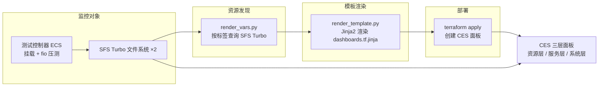

# 架构说明

## 概述

本实践演示如何用 Jinja 模板**动态生成云监控面板**：先按标签发现被监控的 SFS Turbo 文件系统，再用 Jinja2 模板循环渲染出三层监控面板（资源层 / 服务层 / 系统层），通过 Terraform 一键创建到华为云云监控服务（CES）。

核心解决两个问题：

1. **面板数量与资源数量解耦**：文件系统数量变化时，只改标签即可，模板自动循环生成对应面板组件。
2. **面板定义可编程**：面板布局、指标、图例均从模板与变量文件生成，避免在控制台逐个手点。

## 架构图

## 关键组件

| 组件 | 位置 | 职责 |
|---|---|---|
| `scripts/render_vars.py` | scripts/ | 用华为云 SFS SDK 按 `--tag-key` / `--tag-value` 查询文件系统，输出模板变量 JSON |
| `scripts/render_template.py` | scripts/ | 通用 Jinja2 渲染器，把模板渲染为 Terraform 文件 |
| `templates/dashboards.tf.jinja` | templates/ | 监控面板 Terraform 模板：循环生成 `huaweicloud_ces_dashboard_widget` |
| `templates/dashboards.vars.jinja` | templates/ | 变量模板：组装面板渲染所需 JSON |
| `infra/main.tf` | infra/ | 基础设施：VPC、SFS Turbo ×2、测试控制器 ECS、安全组、EIP |
| `scripts/user-data.tftpl` | scripts/ | 测试控制器初始化：安装 nfs/fio 并挂载文件系统 |

## 三层监控设计

与运维惯例对应，面板分为三层：

| 层级 | 面板名 | 内容 | 视角 |
|---|---|---|---|
| 资源层（tier 3） | `sfs-resource-tier-3` | 每个文件系统一组指标（吞吐 / IO / 容量） | 单资源排障 |
| 服务层（tier 2） | `sfs-service-tier-2` | 全部文件系统吞吐聚合 | 服务整体健康 |
| 系统层（tier 1） | `sfs-system-tier-1` | 容量总览表 | 运维值班总览 |

> 面板采用色盲安全友好的图表配色与图例命名，指标单位在组件标题中标注，便于快速辨别读/写方向。

## 数据流

1. `terraform apply` 创建 SFS Turbo 文件系统（打上 `Application=dash-demo` 标签）与测试控制器。
2. `render_vars.py` 查询带该标签的文件系统，渲染出 `dashboards.vars.json`。
3. `render_template.py` 用该 JSON 渲染 `dashboards.tf`（含面板容器 + 组件）。
4. 再次 `terraform apply` 把面板注册到 CES。
5. SSH 登录测试控制器，对挂载的文件系统运行 fio 压测，CES 面板实时呈现指标。

## 设计取舍

- **面板与组件分离**：CES 面板是「容器 + 组件」模型，模板同时渲染容器与组件，组件通过 `dashboard_id` 引用容器，结构与云监控控制台一致。
- **指标展示而非指标计算**：面板直接展示原始指标（吞吐 / IOPS / 容量），不做跨文件系统聚合计算，保持模板简单、指标可溯源。
- **告警规则不在本模板范围**：本样例聚焦面板渲染；告警阈值建议在 CES 控制台按业务水位配置（面板中可快速跳转）。
- **运维通道**：测试控制器绑定 EIP 并通过安全组限制 SSH 来源，用于登录执行压测；生产环境可按需替换为堡垒机或终端节点。